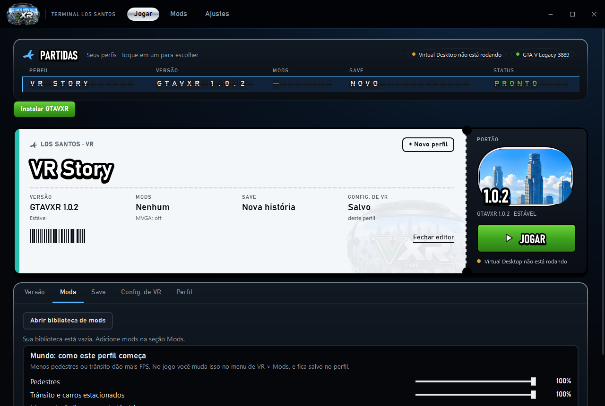
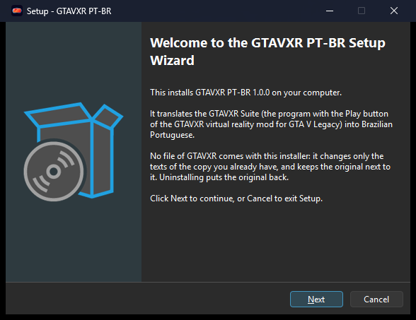
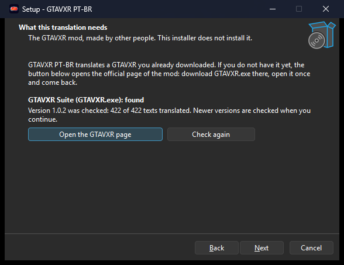
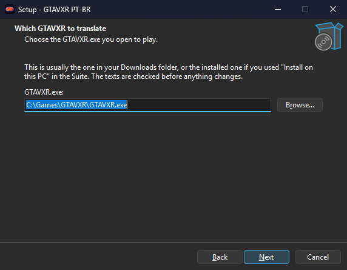
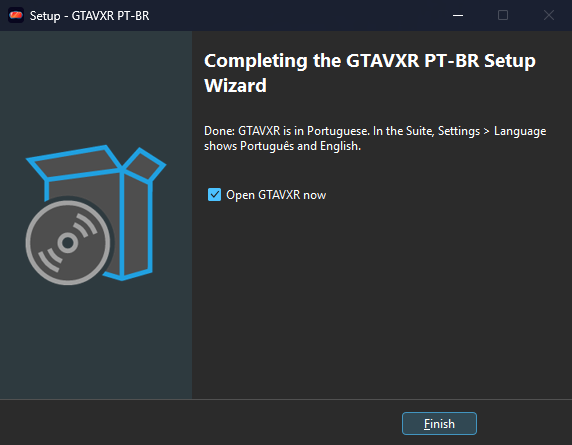
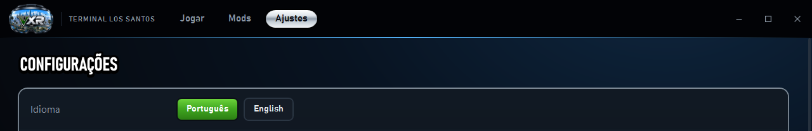

**English** | [Português](README.pt-BR.md)

<div align="center">


# GTAVXR PT-BR

**GTAVXR in Brazilian Portuguese: the Suite and the menus inside the game.**

A small installer that translates GTAVXR, the virtual reality mod for GTA V Legacy: the program you open to play it, and the VR menu and the Trainer you see in the headset. It works on the copy you already have, and uninstalling puts everything back.

[](#-what-you-need)
[](https://github.com/LVL-VR/GTAVXR/releases)
[](README.pt-BR.md)
[](../../releases/latest)
[](LICENSE)

### [⬇️ Download the latest version](../../releases/latest)

[What you need](#-what-you-need) · [Install](#%EF%B8%8F-download-and-install) · [What is translated](#-what-is-translated) · [Known limitations](#%EF%B8%8F-known-limitations) · [Problems?](#-if-something-goes-wrong) · [All the guides](#-guides)



</div>

## 👋 What it is

[GTAVXR](https://github.com/LVL-VR/GTAVXR) is a free mod by LVL-VR that lets you play GTA V Legacy in a virtual reality headset. You open it through a program called the **Suite** (the window with the big **Play** button), which comes in English and Spanish.

GTAVXR PT-BR translates that window into Brazilian Portuguese: every menu, button, message, explanation and the descriptions of the content mods. After installing it, the Suite's language button reads **Português** and **English**.

It also translates the menus you use inside the game, the **VR menu** and the **Trainer**, through a small GTAVXR mod of its own that the installer adds to your GTAVXR library and turns on in your profiles. That mod changes the texts in memory while you play: no file of GTAVXR is changed.

- **Nothing of GTAVXR comes with this installer.** You download GTAVXR from its official page, and this installer only changes the texts of your copy.
- **The original is kept** next to your copy, untouched. Uninstalling GTAVXR PT-BR from Windows puts it back exactly as it was.
- **Your saves are not touched.** What changes is the Suite's language (if you leave that option checked) and, for the in-game menus, the mod **GTAVXR PT-BR menus do jogo** in your GTAVXR library and in the profiles you had. Uninstalling takes both back.

## ✅ What you need

| You need | What it is |
|---|---|
| A PC with Windows 10 or 11 | Where GTAVXR runs |
| [GTAVXR](https://github.com/LVL-VR/GTAVXR/releases) 1.0.2 | The VR mod, made by LVL-VR. Download `GTAVXR.exe` from its official page and open it once |

You do not have to check this by hand. The installer looks for GTAVXR and opens its official page when it is not found. It does not install GTAVXR or any other program for you.

## ⬇️ Download and install

1. Open the [**latest version**](../../releases/latest) and download `GTAVXR-PTBR-Setup-vX.Y.Z.exe`.
2. Close GTAVXR if it is open, and run the file. It installs only for your Windows user and does not ask for an administrator password. The installer is not digitally signed, so Windows may show a warning: choose **More info** and then **Run anyway**.

   

3. One page shows whether GTAVXR was **found**. If it was not, the button opens the official GTAVXR page.

   

4. Confirm which `GTAVXR.exe` to translate: the one you open to play. Usually it is already filled in. When you press **Next**, its texts are checked before anything changes.

   

5. Leave **Switch the Suite language to Portuguese** and **Also translate the menus inside the game** checked, press **Next** and **Install**.
6. On the last page, press **Finish**. GTAVXR opens in Portuguese.
7. In the game, open the VR menu, go to **Settings** and switch **Language** until the texts are in Portuguese. Portuguese takes the place of Spanish there, so the option may still say Spanish. The Trainer follows the VR menu, and has its own **Language** option in its settings too.

   

To go back to the original, uninstall **GTAVXR PT-BR** from the Windows list of installed apps. Every page of the installer is in the [usage guide](docs/usage.md).

## 🌎 What is translated

| Part of GTAVXR | Status |
|---|---|
| The Suite: Play, Mods and Settings pages, messages, profile editor, explanations | ✅ Translated (422 of 422 texts in GTAVXR 1.0.2) |
| Names and descriptions of the content mods in the Suite | ✅ Translated (129 of 129 texts) |
| The VR menu inside the game | ✅ Translated (308 of 308 texts), through the in-game mod |
| The Trainer inside the game | ✅ Translated (776 of 776 texts), through the in-game mod |

The in-game menus are part of GTAVXR's game files, which GTAVXR checks before every launch, so those files are never changed. Instead, the mod **GTAVXR PT-BR menus do jogo** (`GtavxrPtbr.asi`, our own code) is loaded by GTAVXR like any script mod and points the Spanish texts of both menus at Portuguese ones, in memory. The same translation was also offered to the GTAVXR authors, to come built in one day as a third language ([pull request](https://github.com/LVL-VR/GTAVXR/pull/33)). The texts are in [`translations/`](translations).

The in-game mod is also published on its own, as `GTAVXR-PTBR-InGame-vX.Y.Z.zip` in each [release](../../releases/latest), for players who prefer to add it in the Suite themselves.



## ⚠️ Known limitations

- **The in-game menus were tested outside the game.** The mod was checked against copies of the real GTAVXR 1.0.2 files (308 of 308 VR menu texts and 776 of 776 Trainer texts replaced, nothing else changed), and GTAVXR imported it and accepted it as a working mod. A session in the headset with it has not been recorded yet.
- **Portuguese takes the place of Spanish inside the game.** Choose Spanish in the VR menu to see Portuguese; the name of the option may still say Spanish.
- **New profiles start without the in-game mod.** The installer turns it on in the profiles you already have (test profiles are left as they are); for a profile created later or a test profile, turn **GTAVXR PT-BR menus do jogo** on in the Suite.
- **After you update GTAVXR, run this installer again.** A new `GTAVXR.exe` comes in English and Spanish. If the new version has texts this translation does not know yet, the installer says so and changes nothing.
- **The content mods are prepared again once.** The first time you press Play after translating, GTAVXR may rebuild the content mods you use (World of Variety and others), because their descriptions changed language. It happens once and takes a moment.
- **Tested on Windows 11 with GTAVXR 1.0.2**, without a headset in the loop: the translated Suite was opened and every page checked, but a full VR session with this version was not recorded.
- **Not signed digitally**, so Windows SmartScreen may warn before it runs.
- **Use at your own risk.** GTAVXR PT-BR is not made by LVL-VR, and the GTAVXR authors do not support translated copies. If something looks wrong, uninstall it first to see whether the problem is still there.

## 🩺 If something goes wrong

| What happens | What to do |
|---|---|
| "Close GTAVXR (the Suite window)" | Close the GTAVXR window and click **OK** |
| "This GTAVXR version has texts this translation does not know yet" | GTAVXR was updated. Check for a newer GTAVXR PT-BR in [releases](../../releases) |
| "This file is not the GTAVXR Suite" | Choose the `GTAVXR.exe` you open to play |
| The Suite is still in English | In the Suite, open **Settings** and press **Português** |
| The menus inside the game are in English | In the VR menu, open **Settings** and switch **Language** until they are in Portuguese |
| I want the original back | Uninstall **GTAVXR PT-BR** from the Windows list of installed apps |

Every message has its explanation in [Troubleshooting](docs/troubleshooting.md). The installer writes what it did to `%LOCALAPPDATA%\GTAVXR-PTBR\last-run.log`; include that file when you [ask for help](../../issues).

## 📚 Guides

| Guide | What it has |
|---|---|
| [Usage](docs/usage.md) | Every page of the installer, updating, uninstalling, the command line |
| [Troubleshooting](docs/troubleshooting.md) | Every message, why it appears and what to do |
| [Translation guide](docs/translation-guide.md) | The terms and rules used in the translation, to suggest a better word |
| [Architecture](docs/architecture.md) | How the translation is applied, for developers |
| [Third-party notices](THIRD-PARTY-NOTICES.md) | The library the installer carries, and GTAVXR's ownership |

## 🛠️ For developers

The installer carries one small command-line tool, `GtavxrPtbr.exe` (C#, .NET Framework 4.8, [Mono.Cecil](https://github.com/jbevain/cecil)), and the in-game mod, `GtavxrPtbr.asi` (C++). The tool replaces the Spanish column of the Suite's text table with the Portuguese one, keeps English as it is, and writes a backup and a state file so that it can undo the change; it also adds the in-game mod to the GTAVXR library through the Suite's own import command. The mod finds the VR menu and Trainer text tables in memory and points their Spanish column at Portuguese texts. How both work is in the [architecture guide](docs/architecture.md).

```bash
dotnet test -c Release
```

```bash
pwsh scripts/build.ps1
```

The second command builds the installer and the in-game mod package into `dist\` with their `SHA256SUMS.txt` (it needs [Inno Setup](https://jrsoftware.org/isinfo.php) 6.7 or newer, the Microsoft C++ x64 build tools and Python). Every pull request runs the tests, builds the installer and installs it in a clean Windows machine on GitHub; a new version is published from `main` when the version number goes up.

GTAVXR PT-BR is free and open source, under the [MIT license](LICENSE). GTAVXR belongs to LVL-VR; GTA V belongs to Rockstar Games and Take-Two Interactive. This project is not connected to either.
