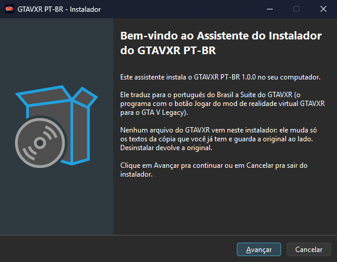

**Português** | [English](README.en.md)

<div align="center">


# GTAVXR PT-BR

**O GTAVXR em português do Brasil: a Suite e os menus de dentro do jogo.**

Um instalador pequeno que traduz o GTAVXR, o mod de realidade virtual para o GTA V Legacy: o programa que você abre para jogar e o menu de VR e o Trainer que você vê no headset. Ele trabalha na cópia que você já tem, e desinstalar devolve tudo.

[](#-o-que-você-precisa)
[](https://github.com/LVL-VR/GTAVXR/releases)
[](README.en.md)
[](../../releases/latest)
[](LICENSE)

### [⬇️ Baixar a última versão](../../releases/latest)

[O que você precisa](#-o-que-você-precisa) · [Instalar](#%EF%B8%8F-baixar-e-instalar) · [O que é traduzido](#-o-que-é-traduzido) · [Limitações conhecidas](#%EF%B8%8F-limitações-conhecidas) · [Problemas?](#-se-algo-der-errado) · [Todos os guias](#-guias)


</div>

## 👋 O que é

O [GTAVXR](https://github.com/LVL-VR/GTAVXR) é um mod gratuito da LVL-VR para jogar o GTA V Legacy num headset de realidade virtual. Você abre o mod por um programa chamado **Suite** (a janela com o botão grande **Play**), que vem em inglês e espanhol.

O GTAVXR PT-BR traduz essa janela para o português do Brasil: todos os menus, botões, mensagens, explicações e as descrições dos mods de conteúdo. Depois de instalar, o botão de idioma da Suite mostra **Português** e **English**.

Ele também traduz os menus que você usa dentro do jogo, o **menu de VR** e o **Trainer**, por um mod pequeno do próprio GTAVXR PT-BR que o instalador adiciona à sua biblioteca do GTAVXR e liga nos seus perfis. Esse mod troca os textos na memória enquanto você joga: nenhum arquivo do GTAVXR é alterado.

- **Nada do GTAVXR vem neste instalador.** Você baixa o GTAVXR da página oficial dele, e este instalador só muda os textos da sua cópia.
- **A original fica guardada** ao lado da sua cópia, intacta. Desinstalar o GTAVXR PT-BR pelo Windows devolve a original exatamente como era.
- **Seus saves não são tocados.** O que muda é o idioma da Suite (se você deixar essa opção marcada) e, para os menus do jogo, o mod **GTAVXR PT-BR menus do jogo** na sua biblioteca do GTAVXR e nos perfis que você tinha. Desinstalar desfaz os dois.

## ✅ O que você precisa

| Você precisa | O que é |
|---|---|
| Um PC com Windows 10 ou 11 | Onde o GTAVXR roda |
| [GTAVXR](https://github.com/LVL-VR/GTAVXR/releases) 1.0.2 | O mod de VR, feito pela LVL-VR. Baixe o `GTAVXR.exe` na página oficial e abra uma vez |

Você não precisa conferir isso à mão. O instalador procura o GTAVXR e abre a página oficial dele quando não encontra. Ele não instala o GTAVXR nem nenhum outro programa para você.

## ⬇️ Baixar e instalar

1. Abra a [**última versão**](../../releases/latest) e baixe o `GTAVXR-PTBR-Setup-vX.Y.Z.exe`.
2. Feche o GTAVXR se estiver aberto e rode o arquivo. Ele instala só para o seu usuário do Windows e não pede senha de administrador. O instalador não tem assinatura digital, então o Windows pode mostrar um aviso: escolha **Mais informações** e depois **Executar assim mesmo**.

   

3. Uma página mostra se o GTAVXR foi **encontrado**. Se não foi, o botão abre a página oficial do GTAVXR.

   

4. Confirme qual `GTAVXR.exe` traduzir: o que você abre para jogar. Em geral ele já vem preenchido. Quando você clica em **Avançar**, os textos dele são conferidos antes de qualquer mudança.

   

5. Deixe marcados **Mudar o idioma da Suite para português** e **Traduzir também os menus de dentro do jogo**, clique em **Avançar** e em **Instalar**.
6. Na última página, clique em **Concluir**. O GTAVXR abre em português.
7. No jogo, abra o menu de VR, vá em **Ajustes** e troque o **Idioma** até os textos ficarem em português. Lá o português ocupa o lugar do espanhol, então a opção ainda pode dizer espanhol. O Trainer segue o menu de VR e também tem a opção **Idioma** nos ajustes dele.

   

Para voltar à original, desinstale o **GTAVXR PT-BR** pela lista de aplicativos instalados do Windows. Todas as páginas do instalador estão no [guia de uso](docs/usage.md).

## 🌎 O que é traduzido

| Parte do GTAVXR | Situação |
|---|---|
| A Suite: páginas Jogar, Mods e Ajustes, mensagens, editor de perfil, explicações | ✅ Traduzida (422 de 422 textos no GTAVXR 1.0.2) |
| Nomes e descrições dos mods de conteúdo na Suite | ✅ Traduzidos (129 de 129 textos) |
| O menu de VR dentro do jogo | ✅ Traduzido (308 de 308 textos), pelo mod dos menus do jogo |
| O Trainer dentro do jogo | ✅ Traduzido (776 de 776 textos), pelo mod dos menus do jogo |

Os menus de dentro do jogo fazem parte dos arquivos de jogo do GTAVXR, que o GTAVXR confere antes de cada partida, então esses arquivos nunca são alterados. Em vez disso, o mod **GTAVXR PT-BR menus do jogo** (`GtavxrPtbr.asi`, código nosso) é carregado pelo GTAVXR como qualquer mod de script e aponta os textos em espanhol dos dois menus para textos em português, na memória. A mesma tradução também foi oferecida aos autores do GTAVXR, para um dia vir embutida como terceiro idioma ([pull request](https://github.com/LVL-VR/GTAVXR/pull/33)). Os textos estão em [`translations/`](translations).

O mod dos menus do jogo também sai sozinho, como `GTAVXR-PTBR-InGame-vX.Y.Z.zip` em cada [versão](../../releases/latest), para quem prefere adicioná-lo na Suite por conta própria.


## ⚠️ Limitações conhecidas

- **Os menus do jogo foram testados fora do jogo.** O mod foi conferido contra cópias dos arquivos reais do GTAVXR 1.0.2 (308 de 308 textos do menu de VR e 776 de 776 do Trainer trocados, nada mais alterado), e o GTAVXR importou e aceitou o mod como mod que funciona. Uma partida no headset com ele ainda não foi registrada.
- **Dentro do jogo, o português ocupa o lugar do espanhol.** Escolha espanhol no menu de VR para ver português; o nome da opção ainda pode dizer espanhol.
- **Perfis novos começam sem o mod dos menus do jogo.** O instalador liga o mod nos perfis que você já tem (perfis de teste ficam como estão); num perfil criado depois ou num perfil de teste, ligue **GTAVXR PT-BR menus do jogo** na Suite.
- **Depois de atualizar o GTAVXR, rode este instalador de novo.** Um `GTAVXR.exe` novo vem em inglês e espanhol. Se a versão nova tiver textos que esta tradução ainda não conhece, o instalador avisa e não muda nada.
- **Os mods de conteúdo são preparados de novo uma vez.** Na primeira vez que você clicar em Jogar depois de traduzir, o GTAVXR pode reconstruir os mods de conteúdo que você usa (World of Variety e outros), porque as descrições deles mudaram de idioma. Acontece uma vez e leva um instante.
- **Testado no Windows 11 com o GTAVXR 1.0.2**, sem headset no circuito: a Suite traduzida foi aberta e cada página conferida, mas uma partida completa em VR com esta versão não foi registrada.
- **Sem assinatura digital**, então o SmartScreen do Windows pode avisar antes de rodar.
- **Use por sua conta e risco.** O GTAVXR PT-BR não é feito pela LVL-VR, e os autores do GTAVXR não dão suporte a cópias traduzidas. Se algo parecer errado, desinstale primeiro para ver se o problema continua.

## 🩺 Se algo der errado

| O que acontece | O que fazer |
|---|---|
| "Feche o GTAVXR (a janela da Suite)" | Feche a janela do GTAVXR e clique em **OK** |
| "Esta versão do GTAVXR tem textos que esta tradução ainda não conhece" | O GTAVXR foi atualizado. Veja se há um GTAVXR PT-BR mais novo nas [versões](../../releases) |
| "Este arquivo não é a Suite do GTAVXR" | Escolha o `GTAVXR.exe` que você abre para jogar |
| A Suite continua em inglês | Na Suite, abra **Ajustes** e clique em **Português** |
| Os menus do jogo estão em inglês | No menu de VR, abra **Ajustes** e troque o **Idioma** até ficarem em português |
| Quero a original de volta | Desinstale o **GTAVXR PT-BR** pela lista de aplicativos instalados do Windows |

Cada mensagem tem a explicação em [Problemas comuns](docs/troubleshooting.md). O instalador registra o que fez em `%LOCALAPPDATA%\GTAVXR-PTBR\last-run.log`; mande esse arquivo junto quando [pedir ajuda](../../issues).

## 📚 Guias

| Guia | O que tem |
|---|---|
| [Uso](docs/usage.md) | Cada página do instalador, atualizar, desinstalar, a linha de comando |
| [Problemas comuns](docs/troubleshooting.md) | Cada mensagem, por que aparece e o que fazer |
| [Guia de tradução](docs/translation-guide.md) | Os termos e regras da tradução, para sugerir uma palavra melhor |
| [Arquitetura](docs/architecture.md) | Como a tradução é aplicada, para quem desenvolve |
| [Avisos de terceiros](THIRD-PARTY-NOTICES.md) | A biblioteca que o instalador leva e a quem pertence o GTAVXR |

## 🛠️ Para quem desenvolve

O instalador leva uma ferramenta pequena de linha de comando, o `GtavxrPtbr.exe` (C#, .NET Framework 4.8, [Mono.Cecil](https://github.com/jbevain/cecil)), e o mod dos menus do jogo, o `GtavxrPtbr.asi` (C++). A ferramenta troca a coluna em espanhol da tabela de textos da Suite pela coluna em português, mantém o inglês como está e grava uma cópia de segurança e um arquivo de estado para conseguir desfazer a mudança; ela também adiciona o mod à biblioteca do GTAVXR pelo próprio comando de importação da Suite. O mod acha na memória as tabelas de textos do menu de VR e do Trainer e aponta a coluna em espanhol para textos em português. Como os dois funcionam está no [guia de arquitetura](docs/architecture.md).

```bash
dotnet test -c Release
```

```bash
pwsh scripts/build.ps1
```

O segundo comando gera o instalador e o pacote do mod dos menus do jogo em `dist\` com o `SHA256SUMS.txt` (precisa do [Inno Setup](https://jrsoftware.org/isinfo.php) 6.7 ou mais novo, das ferramentas de C++ x64 da Microsoft e do Python). Cada pull request roda os testes, gera o instalador e instala numa máquina Windows limpa do GitHub; uma versão nova é publicada a partir da `main` quando o número da versão sobe.

O GTAVXR PT-BR é gratuito e de código aberto, sob a [licença MIT](LICENSE). O GTAVXR pertence à LVL-VR; o GTA V pertence à Rockstar Games e à Take-Two Interactive. Este projeto não tem ligação com nenhuma delas.
