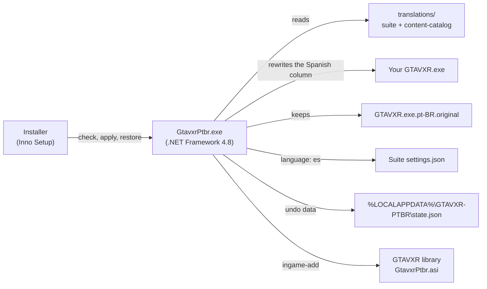
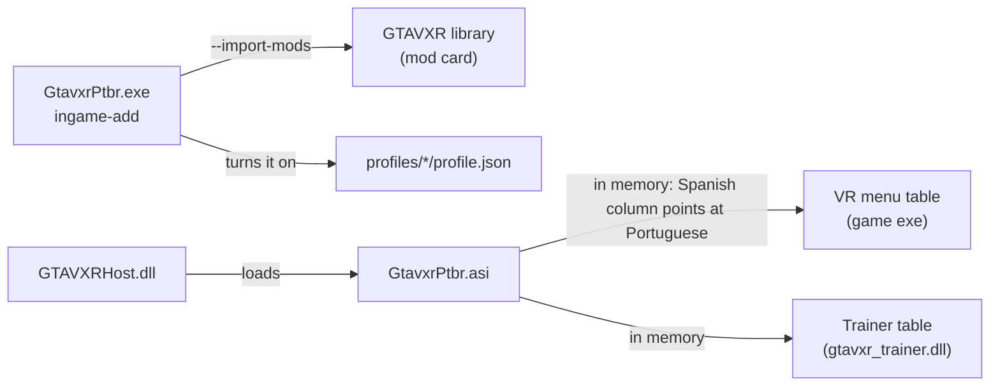

**English** | [Português](architecture.pt-BR.md)

# Architecture

How GTAVXR PT-BR changes the GTAVXR Suite, and how it translates the in-game menus without changing any GTAVXR game file.

## The pieces

- **`installer/gtavxr-ptbr.iss`**: the Inno Setup wizard. It never ships a file of GTAVXR. It finds the Suite, asks which copy to translate, runs `check` from its temporary folder before anything is copied, runs `apply` after copying the tool, then `ingame-add` when that option is checked, and `ingame-remove` and `restore` when uninstalled.
- **`src/GtavxrPtbr`**: the command-line tool. `SuitePatcher` does the rewrite with [Mono.Cecil](https://github.com/jbevain/cecil); `Program` handles the files, the backup, the state and the Suite settings.
- **`src/GtavxrPtbrAsi`**: the in-game mod, `GtavxrPtbr.asi` (C++), with its test (`test_patch.cpp`) and a stand-in for the CI (`fake_tables.cpp`).
- **`translations/`**: four JSON files of `{id, en, pt}` rows. Two go into the Suite; two go into the in-game mod.

## What the Suite looks like inside

The Suite (`GTAVXR.exe`) is a .NET Framework WPF program. Its texts live in three places:

1. **`GtavxrSuite.L`**, a static table `key → {spanish, english}` built in the class constructor. The compiled code for each row is always the same: `ldstr key`, `ldc.i4.2`, `newarr string`, a local store and load, then `ldc.i4.0`, `ldstr spanish`, `stelem.ref`, and the same for index 1 with the English text. The Suite shows column 1 when `settings.json` says `"language": "en"` and column 0 for anything else.
2. **The language button**, a literal `"Español"` in the settings view.
3. **`GtavxrSuite.content-catalog.json`**, an embedded resource with the names and descriptions of the content mods, as `{"es": ..., "en": ...}` pairs.

## The rewrite

GTAVXR PT-BR replaces the **Spanish** column with Portuguese and leaves English untouched:

- In the constructor of `GtavxrSuite.L`, for each `ldstr key; ldc.i4.2; newarr` it looks a few instructions ahead for `ldc.i4.0` followed by `ldstr`, and replaces that operand with the Portuguese text of `key`. Keys without a translation keep their Spanish text and are counted as missing.
- The `"Español"` literal becomes `"Português"`.
- In the catalog resource, a regular expression replaces each `"es"` value whose `"en"` pair has a translation, keeping the rest of the file byte for byte.
- An embedded resource, `GtavxrPtbr.Marker` (it holds the tool name and version), marks the file as translated, so a second run stops with `ALREADY_PATCHED` and `restore` knows the file is the translated one.

Every other resource, including the embedded GTAVXR distribution bundle, is written back unchanged.

So the Suite keeps working as designed: `"en"` shows English, anything else shows the column that now holds Portuguese. That is why `--set-language` writes `"language": "es"`.

## Safety

`apply` works in this order. Up to step 5 a failure leaves the original untouched; if the swap itself fails, the kept original is copied back so `GTAVXR.exe` never goes missing:

1. refuse while the Suite runs from that file (exit 5);
2. read the file and count what is covered; stop below 80% of the table (exit 3) or if already translated (exit 4);
3. write the translated copy to `GTAVXR.exe.pt-BR.tmp` and check that it loads and carries the marker;
4. copy the original to `GTAVXR.exe.pt-BR.original` and compare its SHA-256 with the original;
5. swap the files with `File.Replace`;
6. write `state.json` with both hashes and the paths, right after the swap;
7. only then switch the Suite language (a failure there is a warning) and record the language it had before.

Only one translated copy is tracked: translating a second `GTAVXR.exe` while another is still translated stops with exit 8. A newer GTAVXR PT-BR run on a copy translated by an older one translates again from the kept original, so the texts are refreshed.

`restore` puts the original back only if the file is still the translated copy and the backup still has the recorded hash. After a GTAVXR update in place it leaves the new file as it is; if the file was moved or deleted it keeps the original where it is and says so. It switches the language back only if it is still `"es"`, so a change the player made later is kept.

## The in-game menus: a mod of our own, not a patch

The VR menu (`vr_format_text.h`, 308 texts) and the Trainer (`localization.h`, 776 texts) are compiled into GTAVXR's game files: the VR menu into the game executable that GTAVXR prepares, the Trainer into `gtavxr_trainer.dll`. Before every launch the Suite compares the SHA-256 of each of those files with its own manifest (`versions/gtavxr-1-0-2.json`) and refuses to start with `INSTALL_RUNTIME_CHANGED` when one differs. So those files are never changed.

What GTAVXR does allow is script mods: `.asi` files written for ScriptHookV, which its host (`GTAVXRHost.dll`) loads into the game when a profile has the mod turned on. GTAVXR PT-BR ships one, `GtavxrPtbr.asi` (`src/GtavxrPtbrAsi`, C++, all our own code), and the installer adds it to the GTAVXR library with the Suite's own import command (`GTAVXR.exe --import-mods`).

Both tables are arrays of pointers to C strings: the VR menu rows are `{source, english, spanish}` and the Trainer rows `{english, spanish}`. Once a second, the mod:

1. finds each table in the loaded module's read-only data: it looks for a pointer to a text that is always in the table (`"SETTINGS / AJUSTES"` for the VR menu, `"Previous Trainer Options"` for the Trainer), then walks back and forward over rows whose every column points at a valid string, and keeps the longest run; it accepts the table only when at least 70% of its keys are known texts, so a table laid out differently (for example with a Portuguese column of GTAVXR's own) is left alone instead of being written out of step;
2. for each row whose key (the source text, or the English text for the Trainer) has a translation, makes the page writable and points the Spanish column at the Portuguese text, which lives in the mod itself;
3. holds a reference to the Trainer while it reads it, and gives up (instead of crashing the game) if a page cannot be read;
4. writes how many rows it found and replaced to `%LOCALAPPDATA%\GTAVXR-PTBR\in-game.log`.

The VR menu is translated once per game process. The Trainer DLL can be reloaded by GTAVXR during a session, so the mod checks whether the table it patched is still there and patches again when it is new.

Why this is safe for GTAVXR's check: the files on disk keep their exact bytes, so their hashes still match the manifest; only the running copy in memory changes, and only the Spanish column. Portuguese therefore appears when the game language is Spanish. If a future GTAVXR moves or renames the texts, the anchor is not found, the mod changes nothing and says so in its log.

The texts come from `translations/vr-menu.pt-BR.json` and `translations/trainer.pt-BR.json`; `scripts/gen_asi_texts.py` turns them into `src/GtavxrPtbrAsi/texts.g.h`, and the CI fails when that file is out of date. The same translation was also offered to the GTAVXR project to be built in as a third language ([pull request](https://github.com/LVL-VR/GTAVXR/pull/33)); the mod does not depend on it.

`ingame-add` writes `%LOCALAPPDATA%\GTAVXR-PTBR\in-game.json` with the card id and the profiles it turned the mod on in; `ingame-remove` (run by the uninstaller before `restore`) turns it off in those profiles, deletes the card and the files that only it used.

## Side effect: content mods rebuilt once

The hash of the catalog resource is part of the key the Suite uses to decide whether a content mod must be prepared again. After translating, the first Play rebuilds the content mods in use. This is listed in the known limitations.

## Tests and pipeline

- `tests/GtavxrPtbr.Tests/PatcherTests.cs` builds a small stand-in Suite with Mono.Cecil (same IL pattern, the `"Español"` literal and a catalog resource) and checks the rewrite, the marker, refusals and the catalog escaping.
- `tests/GtavxrPtbr.Tests/TranslationFileTests.cs` checks every translation file: same placeholders as English, no empty row, no long dash, unique ids.
- `src/GtavxrPtbrAsi/test_patch.cpp` loads a GTAVXR game file without running it, applies the in-game patch and checks that every known row became Portuguese, every unknown row kept its text, the other columns did not change and a second run changes nothing. The CI runs it against `fake_tables.dll`, a stand-in laid out like the real tables.
- `.github/workflows/ci.yml` runs the tests on every push. `.github/workflows/release.yml` builds the installer, installs and uninstalls it on a clean Windows runner, and publishes a release from `main` when the version in `GtavxrPtbr.csproj` has no tag yet.

The real `GTAVXR.exe` is not in the repository (it belongs to LVL-VR). Each release is also checked by hand against the real GTAVXR 1.0.2: `check` reports 422/422 Suite texts and 129/129 catalog texts, `apply` and `restore` round-trip to the original SHA-256, and the translated Suite is opened and its pages read. The in-game mod is checked with `test_patch` against copies of the real game exe and `gtavxr_trainer.dll` (308/308 and 776/776), and `ingame-add` and `ingame-remove` are run against a copy of the Suite data folder.
