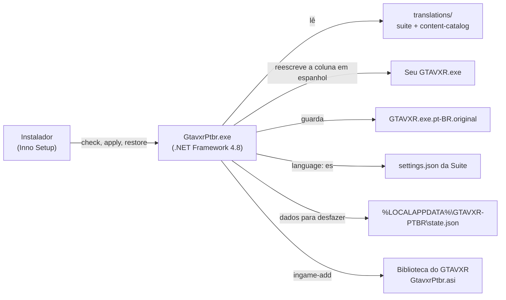
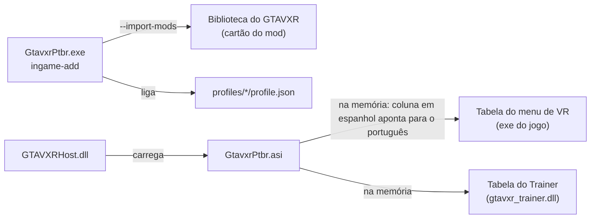

[English](architecture.md) | **Português**

# Arquitetura

Como o GTAVXR PT-BR muda a Suite do GTAVXR, e como traduz os menus de dentro do jogo sem alterar nenhum arquivo de jogo do GTAVXR.

## As peças

- **`installer/gtavxr-ptbr.iss`**: o assistente do Inno Setup. Nunca leva arquivo do GTAVXR. Encontra a Suite, pergunta qual cópia traduzir, roda o `check` a partir da pasta temporária antes de copiar qualquer coisa, roda o `apply` depois de copiar a ferramenta, depois o `ingame-add` quando essa opção está marcada, e o `ingame-remove` e o `restore` na desinstalação.
- **`src/GtavxrPtbr`**: a ferramenta de linha de comando. `SuitePatcher` faz a reescrita com o [Mono.Cecil](https://github.com/jbevain/cecil); `Program` cuida dos arquivos, da cópia de segurança, do estado e dos ajustes da Suite.
- **`src/GtavxrPtbrAsi`**: o mod dos menus do jogo, `GtavxrPtbr.asi` (C++), com o teste dele (`test_patch.cpp`) e uma imitação para o CI (`fake_tables.cpp`).
- **`translations/`**: quatro arquivos JSON de linhas `{id, en, pt}`. Dois vão para a Suite; dois vão para o mod dos menus do jogo.

## Como a Suite é por dentro

A Suite (`GTAVXR.exe`) é um programa WPF do .NET Framework. Os textos dela ficam em três lugares:

1. **`GtavxrSuite.L`**, uma tabela estática `chave → {espanhol, inglês}` montada no construtor da classe. O código compilado de cada linha é sempre igual: `ldstr chave`, `ldc.i4.2`, `newarr string`, um store e um load de variável local, depois `ldc.i4.0`, `ldstr espanhol`, `stelem.ref`, e o mesmo para o índice 1 com o texto em inglês. A Suite mostra a coluna 1 quando o `settings.json` diz `"language": "en"` e a coluna 0 para qualquer outro valor.
2. **O botão de idioma**, um literal `"Español"` na tela de ajustes.
3. **`GtavxrSuite.content-catalog.json`**, um recurso embutido com os nomes e descrições dos mods de conteúdo, em pares `{"es": ..., "en": ...}`.

## A reescrita

O GTAVXR PT-BR troca a coluna em **espanhol** pelo português e não mexe no inglês:

- No construtor de `GtavxrSuite.L`, para cada `ldstr chave; ldc.i4.2; newarr`, procura algumas instruções adiante um `ldc.i4.0` seguido de `ldstr` e troca esse operando pelo texto em português da `chave`. Chaves sem tradução mantêm o espanhol e entram na conta das que faltam.
- O literal `"Español"` vira `"Português"`.
- No recurso do catálogo, uma expressão regular troca cada valor `"es"` cujo par `"en"` tem tradução, mantendo o resto do arquivo byte a byte.
- Um recurso embutido, `GtavxrPtbr.Marker` (guarda o nome e a versão da ferramenta), marca o arquivo como traduzido, para que uma segunda execução pare com `ALREADY_PATCHED` e o `restore` saiba que o arquivo é o traduzido.

Todos os outros recursos, inclusive o pacote de distribuição do GTAVXR embutido, são regravados sem mudança.

Assim a Suite continua funcionando como foi feita: `"en"` mostra o inglês, qualquer outro valor mostra a coluna que agora tem o português. Por isso o `--set-language` grava `"language": "es"`.

## Segurança

O `apply` segue esta ordem. Até o passo 5 uma falha deixa o original intacto; se a própria troca falhar, a original guardada é copiada de volta, para o `GTAVXR.exe` nunca sumir:

1. recusa enquanto a Suite estiver rodando a partir daquele arquivo (saída 5);
2. lê o arquivo e conta o que é coberto; para abaixo de 80% da tabela (saída 3) ou se já estiver traduzido (saída 4);
3. grava a cópia traduzida em `GTAVXR.exe.pt-BR.tmp` e confere que ela carrega e tem a marca;
4. copia o original para `GTAVXR.exe.pt-BR.original` e compara o SHA-256 com o original;
5. troca os arquivos com `File.Replace`;
6. grava o `state.json` com os dois hashes e os caminhos, logo depois da troca;
7. só então muda o idioma da Suite (uma falha aí é só aviso) e registra o idioma que estava antes.

Só uma cópia traduzida é acompanhada: traduzir um segundo `GTAVXR.exe` enquanto outro ainda está traduzido para com a saída 8. Um GTAVXR PT-BR mais novo rodando numa cópia traduzida por um mais antigo traduz de novo a partir da original guardada, então os textos são atualizados.

O `restore` só devolve o original se o arquivo ainda for a cópia traduzida e a cópia de segurança ainda tiver o hash registrado. Depois de uma atualização do GTAVXR no mesmo lugar, deixa o arquivo novo como está; se o arquivo foi movido ou apagado, mantém a original onde está e avisa. Ele só volta o idioma se ainda estiver em `"es"`, para manter uma mudança que a pessoa tenha feito depois.

## Os menus do jogo: um mod nosso, não um patch

O menu de VR (`vr_format_text.h`, 308 textos) e o Trainer (`localization.h`, 776 textos) são compilados nos arquivos de jogo do GTAVXR: o menu de VR no executável do jogo que o GTAVXR prepara, o Trainer no `gtavxr_trainer.dll`. Antes de cada partida a Suite compara o SHA-256 de cada um desses arquivos com o manifesto dela (`versions/gtavxr-1-0-2.json`) e se recusa a abrir com `INSTALL_RUNTIME_CHANGED` quando algum é diferente. Por isso esses arquivos nunca são alterados.

O que o GTAVXR permite são mods de script: arquivos `.asi` feitos para o ScriptHookV, que o host dele (`GTAVXRHost.dll`) carrega no jogo quando o perfil tem o mod ligado. O GTAVXR PT-BR leva um, o `GtavxrPtbr.asi` (`src/GtavxrPtbrAsi`, C++, todo código nosso), e o instalador adiciona ele à biblioteca do GTAVXR pelo próprio comando de importação da Suite (`GTAVXR.exe --import-mods`).

As duas tabelas são listas de ponteiros para textos em C: as linhas do menu de VR são `{source, english, spanish}` e as do Trainer `{english, spanish}`. Uma vez por segundo, o mod:

1. acha cada tabela nos dados somente leitura do módulo carregado: procura um ponteiro para um texto que sempre está na tabela (`"SETTINGS / AJUSTES"` no menu de VR, `"Previous Trainer Options"` no Trainer), anda para trás e para frente pelas linhas em que toda coluna aponta para um texto válido e fica com a sequência mais longa; só aceita a tabela quando pelo menos 70% das chaves são textos conhecidos, então uma tabela montada de outro jeito (por exemplo com uma coluna em português do próprio GTAVXR) fica como está, em vez de ser escrita fora do lugar;
2. em cada linha cuja chave (o texto de origem, ou o texto em inglês no Trainer) tem tradução, libera a escrita na página e aponta a coluna em espanhol para o texto em português, que mora no próprio mod;
3. segura uma referência ao Trainer enquanto lê, e desiste (em vez de derrubar o jogo) se uma página não puder ser lida;
4. grava quantas linhas achou e trocou em `%LOCALAPPDATA%\GTAVXR-PTBR\in-game.log`.

O menu de VR é traduzido uma vez por processo do jogo. A DLL do Trainer pode ser recarregada pelo GTAVXR durante a partida, então o mod confere se a tabela que ele trocou ainda está lá e troca de novo quando ela é nova.

Por que isso é seguro para a conferência do GTAVXR: os arquivos no disco ficam com os mesmos bytes, então os hashes continuam batendo com o manifesto; só a cópia em execução na memória muda, e só a coluna em espanhol. Por isso o português aparece quando o idioma do jogo é espanhol. Se um GTAVXR futuro mover ou renomear os textos, a âncora não é achada, o mod não muda nada e diz isso no log.

Os textos vêm de `translations/vr-menu.pt-BR.json` e `translations/trainer.pt-BR.json`; o `scripts/gen_asi_texts.py` transforma eles em `src/GtavxrPtbrAsi/texts.g.h`, e o CI falha quando esse arquivo está desatualizado. A mesma tradução também foi oferecida ao projeto GTAVXR para vir embutida como terceiro idioma ([pull request](https://github.com/LVL-VR/GTAVXR/pull/33)); o mod não depende disso.

O `ingame-add` grava `%LOCALAPPDATA%\GTAVXR-PTBR\in-game.json` com o id do cartão e os perfis em que ligou o mod; o `ingame-remove` (rodado pelo desinstalador antes do `restore`) desliga nesses perfis, apaga o cartão e os arquivos que só ele usava.

## Efeito colateral: mods de conteúdo reconstruídos uma vez

O hash do recurso do catálogo faz parte da chave que a Suite usa para decidir se um mod de conteúdo precisa ser preparado de novo. Depois de traduzir, o primeiro Jogar reconstrói os mods de conteúdo em uso. Isso está nas limitações conhecidas.

## Testes e esteira

- `tests/GtavxrPtbr.Tests/PatcherTests.cs` monta com o Mono.Cecil uma Suite de mentira (mesmo padrão de IL, o literal `"Español"` e um recurso de catálogo) e confere a reescrita, a marca, as recusas e o escape do catálogo.
- `tests/GtavxrPtbr.Tests/TranslationFileTests.cs` confere cada arquivo de tradução: mesmos marcadores do inglês, nenhuma linha vazia, nenhum travessão, ids únicos.
- `src/GtavxrPtbrAsi/test_patch.cpp` carrega um arquivo de jogo do GTAVXR sem executar, aplica a troca dos menus do jogo e confere que toda linha conhecida virou português, toda linha desconhecida manteve o texto, as outras colunas não mudaram e uma segunda execução não muda nada. O CI roda esse teste contra o `fake_tables.dll`, uma imitação montada como as tabelas reais.
- `.github/workflows/ci.yml` roda os testes a cada push. `.github/workflows/release.yml` gera o instalador, instala e desinstala numa máquina Windows limpa e publica uma versão a partir da `main` quando a versão do `GtavxrPtbr.csproj` ainda não tem tag.

O `GTAVXR.exe` real não está no repositório (ele pertence à LVL-VR). Cada versão também é conferida à mão contra o GTAVXR 1.0.2 real: o `check` mostra 422/422 textos da Suite e 129/129 do catálogo, `apply` e `restore` voltam ao SHA-256 original, e a Suite traduzida é aberta e as páginas lidas. O mod dos menus do jogo é conferido com o `test_patch` contra cópias do exe real do jogo e do `gtavxr_trainer.dll` (308/308 e 776/776), e o `ingame-add` e o `ingame-remove` rodam contra uma cópia da pasta de dados da Suite.
