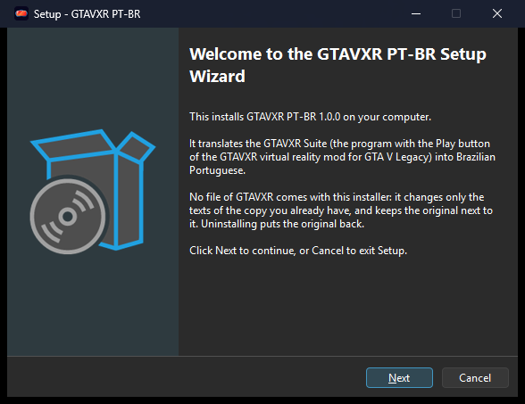
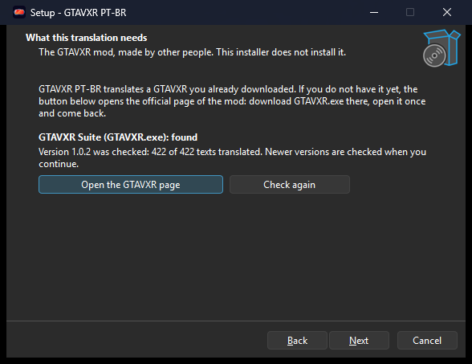
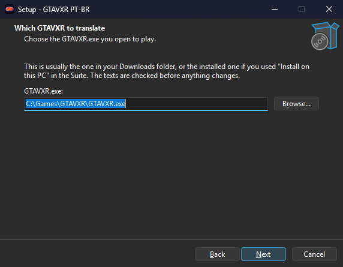
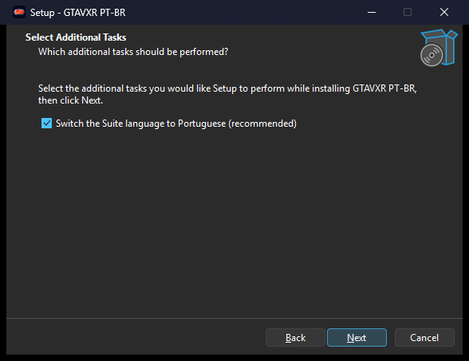
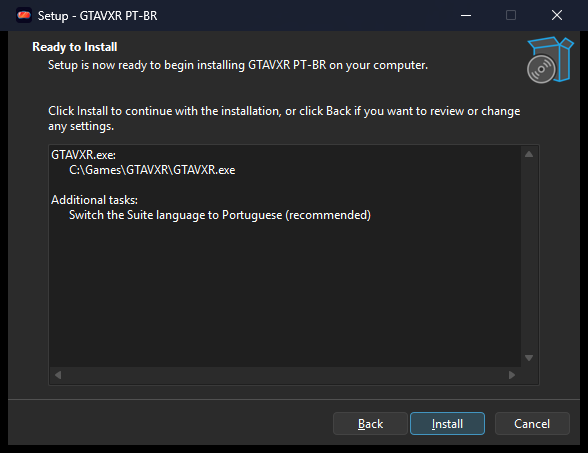
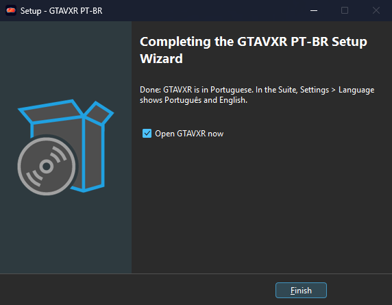

**English** | [Português](usage.pt-BR.md)

# Usage

## Before you start

- GTAVXR is downloaded: the `GTAVXR.exe` from the [official page](https://github.com/LVL-VR/GTAVXR/releases), opened at least once.
- GTAVXR is closed.

## The installer, page by page

1. **Welcome.** What the installer does: it translates the copy of GTAVXR you already have and keeps the original next to it.

   

2. **What this translation needs.** Shows whether the GTAVXR Suite was **found** in the usual places: your Downloads folder, your Desktop, or the folder where the Suite installs itself when you use **Install on this PC** in its settings. **Open the GTAVXR page** opens the official download page. **Check again** looks once more, after you download it.

   

3. **Which GTAVXR to translate.** The `GTAVXR.exe` you open to play. **Browse** lets you choose another one. When you press **Next**, the texts of that file are checked; nothing changes yet.

   

4. **Additional tasks.** Two options, both checked:
   - **Switch the Suite language to Portuguese.** Unchecked, the translation is applied but the Suite opens in the language it had; you can switch it later in **Settings**.
   - **Also translate the menus inside the game.** Adds the mod **GTAVXR PT-BR menus do jogo** to your GTAVXR library and turns it on in the profiles you have, so the VR menu and the Trainer show Portuguese. Unchecked, only the Suite is translated.

   

5. **Ready to install.** A summary of the file and the option. **Install** copies the small tool and translates the file.

   

6. **Finish.** Says that GTAVXR is in Portuguese, and whether the in-game menus mod was added. **Open GTAVXR now** opens the translated Suite.

   

The pictures above are from version 1.0; version 1.1 adds the second option on the **Additional tasks** page.

## The menus inside the game

With the in-game menus mod on, start GTAVXR as usual. In the game, open the VR menu, go to **Settings** and switch **Language** until the texts are in Portuguese: Portuguese takes the place of Spanish, so the option may still say Spanish. The Trainer follows the VR menu; it also has its own **Language** option, where Spanish now shows Portuguese.

A profile created after the install starts without the mod, and test profiles are left as they are. To use it there, turn **GTAVXR PT-BR menus do jogo** on in that profile in the Suite.

The mod is also published on its own, as `GTAVXR-PTBR-InGame-vX.Y.Z.zip` in each release: add that .zip as a mod in the Suite and turn it on in your profile.

## What changes on your computer

| Where | What |
|---|---|
| Your `GTAVXR.exe` | Its Spanish texts are replaced by Portuguese ones; English stays as it is |
| `GTAVXR.exe.pt-BR.original`, next to it | The original file, untouched |
| The Suite `settings.json` (`%LOCALAPPDATA%\GTAVXR\Suite`, or the data folder chosen in the Suite) | `"language"` set to the Portuguese column, only with the option checked |
| `%LOCALAPPDATA%\Programs\GTAVXR PT-BR` | The tool, its translations and the uninstaller |
| The GTAVXR library (the Suite data folder) | The mod **GTAVXR PT-BR menus do jogo** (`GtavxrPtbr.asi`), only with the in-game option checked |
| Each profile's `profile.json` | The mod turned on, only with the in-game option checked |
| `%LOCALAPPDATA%\GTAVXR-PTBR` | `state.json` (what to undo), `in-game.json` (which mod and profiles to undo) and `last-run.log` (what the last run did) |
| `%LOCALAPPDATA%\GTAVXR-PTBR\in-game.log` | What the in-game mod did in the last session (how many texts it replaced) |

No file of GTAVXR's game is changed: the in-game mod changes the texts in memory while the game runs, so GTAVXR's check of its game files still passes.

## When GTAVXR is updated

A new `GTAVXR.exe` comes in English and Spanish only. Run the GTAVXR PT-BR installer again and choose the new file.

- If you installed a newer GTAVXR PT-BR, the same run also brings its new texts.
- If the new version has the same texts, it is translated as before.
- If at least 80% of its texts are known, it is translated, and the new texts stay in Spanish until a new GTAVXR PT-BR comes out.
- Below that, the installer says the version is not covered yet and changes nothing.

If the Suite updated itself in place, the backup of the old version no longer matches it; uninstalling then leaves the new file as it is.

## Uninstall

Windows Settings, **Apps**, **Installed apps**, **GTAVXR PT-BR**, **Uninstall**. The uninstaller:

1. takes the in-game menus mod out of your profiles and the GTAVXR library (if you had added that mod yourself before installing, it stays in the library);
2. puts the original `GTAVXR.exe` back, if your copy is still the translated one;
3. switches the Suite language back to what it was before, if it is still on the Portuguese column;
4. removes the tool and its state file (the folder `%LOCALAPPDATA%\GTAVXR-PTBR` keeps only `last-run.log`).

If GTAVXR is open, it asks you to close it first; **Cancel** stops the uninstall and changes nothing. If your `GTAVXR.exe` was moved or deleted, the original stays where it was kept, `GTAVXR.exe.pt-BR.original`.

Only one copy of `GTAVXR.exe` is translated at a time. To translate a different copy, uninstall first. A newer GTAVXR PT-BR installed over an older one updates the texts of the copy it translated.

## Command line

The installed tool can be used directly from `%LOCALAPPDATA%\Programs\GTAVXR PT-BR`:

```bash
GtavxrPtbr find
```

```bash
GtavxrPtbr check --exe "C:\path\to\GTAVXR.exe"
```

```bash
GtavxrPtbr apply --exe "C:\path\to\GTAVXR.exe" --set-language
```

```bash
GtavxrPtbr status
```

```bash
GtavxrPtbr restore
```

```bash
GtavxrPtbr ingame-add --exe "C:\path\to\GTAVXR.exe" --mod "GTAVXR PT-BR menus do jogo.zip"
```

```bash
GtavxrPtbr ingame-remove
```

`ingame-add` imports the mod through the Suite's own import command and turns it on in every profile; `ingame-remove` undoes it. Both need GTAVXR closed.

| Exit code | Meaning |
|---|---|
| 0 | Done |
| 1 | Error (the message says which) |
| 2 | Wrong command or option |
| 3 | This GTAVXR version is not covered yet (less than 80% of its texts are known) |
| 4 | Already translated |
| 5 | GTAVXR is running |
| 6 | Nothing to restore (or no in-game mod to remove) |
| 7 | The file is not the GTAVXR Suite |
| 8 | Another copy is already translated (uninstall first) |

The installer also accepts `/SUITE="C:\path\to\GTAVXR.exe"` to choose the file, which makes a silent install possible:

```bash
GTAVXR-PTBR-Setup-v1.1.0.exe /VERYSILENT /SUITE="C:\Games\GTAVXR\GTAVXR.exe"
```
