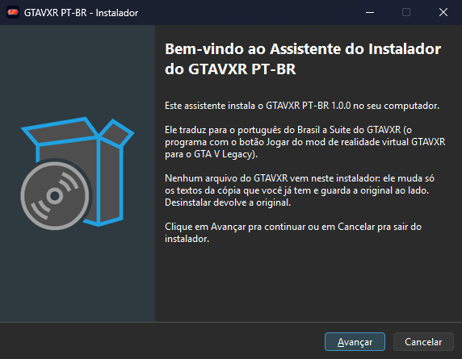
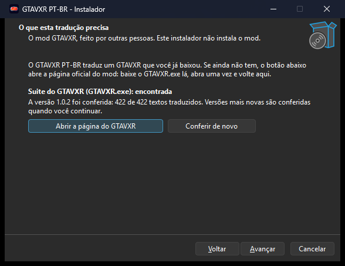
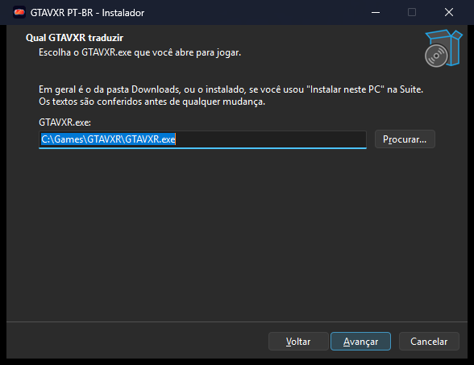
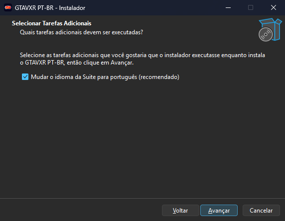
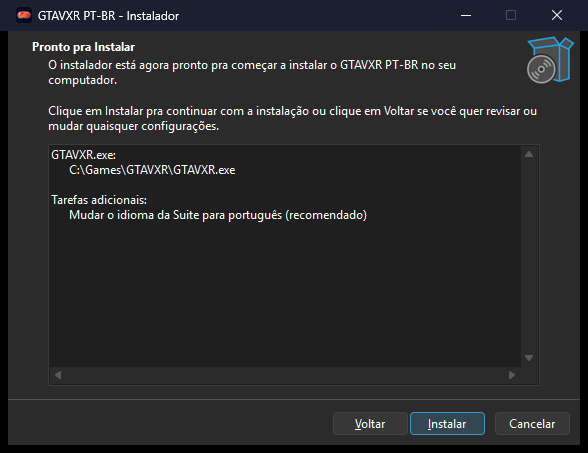
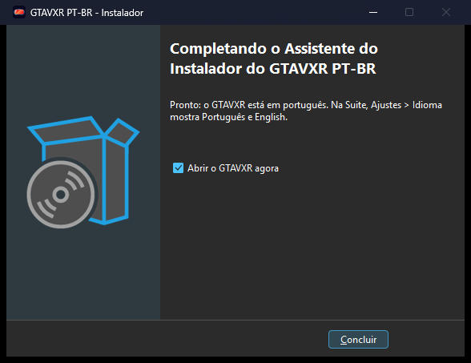

**Português** | [English](usage.en.md)

# Uso

## Antes de começar

- O GTAVXR está baixado: o `GTAVXR.exe` da [página oficial](https://github.com/LVL-VR/GTAVXR/releases), aberto pelo menos uma vez.
- O GTAVXR está fechado.

## O instalador, página por página

1. **Boas-vindas.** O que o instalador faz: traduz a cópia do GTAVXR que você já tem e guarda a original ao lado.

   

2. **O que esta tradução precisa.** Mostra se a Suite do GTAVXR foi **encontrada** nos lugares de costume: a pasta Downloads, a Área de Trabalho, ou a pasta onde a Suite se instala quando você usa **Instalar neste PC** nos ajustes dela. **Abrir a página do GTAVXR** abre a página oficial de download. **Conferir de novo** procura outra vez, depois que você baixar.

   

3. **Qual GTAVXR traduzir.** O `GTAVXR.exe` que você abre para jogar. **Procurar** deixa escolher outro. Quando você clica em **Avançar**, os textos desse arquivo são conferidos; nada muda ainda.

   

4. **Tarefas adicionais.** Duas opções, as duas marcadas:
   - **Mudar o idioma da Suite para português.** Desmarcada, a tradução é aplicada mas a Suite abre no idioma que tinha; dá para trocar depois em **Ajustes**.
   - **Traduzir também os menus de dentro do jogo.** Adiciona o mod **GTAVXR PT-BR menus do jogo** à sua biblioteca do GTAVXR e liga ele nos perfis que você tem, para o menu de VR e o Trainer mostrarem português. Desmarcada, só a Suite é traduzida.

   

5. **Pronto para instalar.** Um resumo do arquivo e da opção. **Instalar** copia a ferramenta pequena e traduz o arquivo.

   

6. **Concluir.** Diz que o GTAVXR está em português e se o mod dos menus do jogo foi adicionado. **Abrir o GTAVXR agora** abre a Suite traduzida.

   

As imagens acima são da versão 1.0; a versão 1.1 acrescenta a segunda opção na página **Tarefas adicionais**.

## Os menus de dentro do jogo

Com o mod dos menus do jogo ligado, abra o GTAVXR como sempre. No jogo, abra o menu de VR, vá em **Ajustes** e troque o **Idioma** até os textos ficarem em português: o português ocupa o lugar do espanhol, então a opção ainda pode dizer espanhol. O Trainer segue o menu de VR; ele também tem a opção **Idioma** própria, onde espanhol agora mostra português.

Um perfil criado depois da instalação começa sem o mod, e perfis de teste ficam como estão. Para usar nele, ligue **GTAVXR PT-BR menus do jogo** nesse perfil, na Suite.

O mod também sai sozinho, como `GTAVXR-PTBR-InGame-vX.Y.Z.zip` em cada versão: adicione esse .zip como mod na Suite e ligue no seu perfil.

## O que muda no seu computador

| Onde | O quê |
|---|---|
| O seu `GTAVXR.exe` | Os textos em espanhol viram português; o inglês fica como está |
| `GTAVXR.exe.pt-BR.original`, ao lado | O arquivo original, intacto |
| O `settings.json` da Suite (`%LOCALAPPDATA%\GTAVXR\Suite`, ou a pasta de dados escolhida na Suite) | `"language"` na coluna em português, só com a opção marcada |
| `%LOCALAPPDATA%\Programs\GTAVXR PT-BR` | A ferramenta, as traduções e o desinstalador |
| A biblioteca do GTAVXR (a pasta de dados da Suite) | O mod **GTAVXR PT-BR menus do jogo** (`GtavxrPtbr.asi`), só com a opção dos menus do jogo marcada |
| O `profile.json` de cada perfil | O mod ligado, só com a opção dos menus do jogo marcada |
| `%LOCALAPPDATA%\GTAVXR-PTBR` | `state.json` (o que desfazer), `in-game.json` (qual mod e quais perfis desfazer) e `last-run.log` (o que a última execução fez) |
| `%LOCALAPPDATA%\GTAVXR-PTBR\in-game.log` | O que o mod dos menus do jogo fez na última partida (quantos textos trocou) |

Nenhum arquivo de jogo do GTAVXR é alterado: o mod troca os textos na memória enquanto o jogo roda, então a conferência que o GTAVXR faz dos arquivos de jogo continua passando.

## Quando o GTAVXR atualizar

Um `GTAVXR.exe` novo vem só em inglês e espanhol. Rode de novo o instalador do GTAVXR PT-BR e escolha o arquivo novo.

- Se você instalou um GTAVXR PT-BR mais novo, a mesma execução já traz os textos novos dele.
- Se a versão nova tiver os mesmos textos, ela é traduzida como antes.
- Se pelo menos 80% dos textos forem conhecidos, ela é traduzida, e os textos novos ficam em espanhol até sair um GTAVXR PT-BR novo.
- Abaixo disso, o instalador avisa que a versão ainda não é coberta e não muda nada.

Se a Suite se atualizou no mesmo lugar, a cópia de segurança da versão antiga não corresponde mais a ela; a desinstalação então deixa o arquivo novo como está.

## Desinstalar

Configurações do Windows, **Aplicativos**, **Aplicativos instalados**, **GTAVXR PT-BR**, **Desinstalar**. O desinstalador:

1. tira o mod dos menus do jogo dos seus perfis e da biblioteca do GTAVXR (se você já tinha adicionado esse mod antes de instalar, ele fica na biblioteca);
2. devolve o `GTAVXR.exe` original, se a sua cópia ainda for a traduzida;
3. volta o idioma da Suite ao que era antes, se ele ainda estiver na coluna em português;
4. remove a ferramenta e o arquivo de estado (a pasta `%LOCALAPPDATA%\GTAVXR-PTBR` fica só com o `last-run.log`).

Se o GTAVXR estiver aberto, ele pede para fechar antes; **Cancelar** interrompe a desinstalação sem mudar nada. Se o seu `GTAVXR.exe` foi movido ou apagado, a original continua onde foi guardada, `GTAVXR.exe.pt-BR.original`.

Só uma cópia do `GTAVXR.exe` fica traduzida por vez. Para traduzir outra cópia, desinstale antes. Um GTAVXR PT-BR mais novo instalado por cima de um mais antigo atualiza os textos da cópia que ele traduziu.

## Linha de comando

A ferramenta instalada pode ser usada direto de `%LOCALAPPDATA%\Programs\GTAVXR PT-BR`:

```bash
GtavxrPtbr find
```

```bash
GtavxrPtbr check --exe "C:\caminho\para\GTAVXR.exe"
```

```bash
GtavxrPtbr apply --exe "C:\caminho\para\GTAVXR.exe" --set-language
```

```bash
GtavxrPtbr status
```

```bash
GtavxrPtbr restore
```

```bash
GtavxrPtbr ingame-add --exe "C:\caminho\para\GTAVXR.exe" --mod "GTAVXR PT-BR menus do jogo.zip"
```

```bash
GtavxrPtbr ingame-remove
```

`ingame-add` importa o mod pelo próprio comando de importação da Suite e liga ele em todos os perfis; `ingame-remove` desfaz. Os dois precisam do GTAVXR fechado.

| Código de saída | Significado |
|---|---|
| 0 | Feito |
| 1 | Erro (a mensagem diz qual) |
| 2 | Comando ou opção errada |
| 3 | Esta versão do GTAVXR ainda não é coberta (menos de 80% dos textos conhecidos) |
| 4 | Já traduzido |
| 5 | O GTAVXR está aberto |
| 6 | Nada para devolver (ou nenhum mod dos menus do jogo para tirar) |
| 7 | O arquivo não é a Suite do GTAVXR |
| 8 | Outra cópia já está traduzida (desinstale antes) |

O instalador também aceita `/SUITE="C:\caminho\para\GTAVXR.exe"` para escolher o arquivo, o que permite instalar em silêncio:

```bash
GTAVXR-PTBR-Setup-v1.1.0.exe /VERYSILENT /SUITE="C:\Games\GTAVXR\GTAVXR.exe"
```
